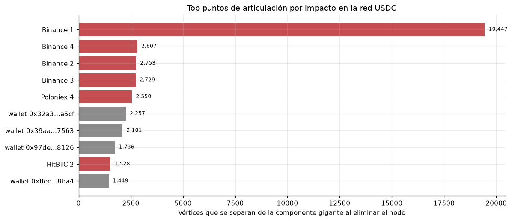
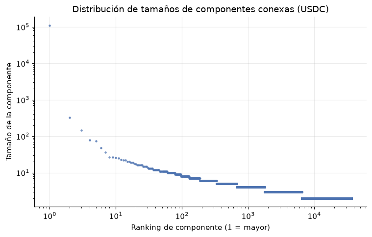

# 3. Tarea 1 — Fragmentación y puntos críticos de la red USDC

## 3.1 Problema real y modelo de grafos

USDC se usa para pagos y liquidación entre exchanges, market makers y billeteras. Si la red está fragmentada, una dirección puede quedar aislada de la liquidez principal. Si además existen **puntos de articulación** —direcciones cuya eliminación desconecta la red— esos nodos son riesgos sistémicos: un exchange, un contrato o una billetera puente puede ser el único camino entre dos comunidades.

Sea `G = (V, E)` un grafo **no dirigido y no ponderado**:

- `V`: direcciones que participan en al menos una transferencia USDC de la muestra.
- `{u, v} ∈ E`: existe al menos una transferencia USDC entre `u` y `v`, en cualquier dirección. Se eliminan auto-lazos y la dirección cero.
- El peso no se usa: interesa la **conectividad estructural**, no cuánto se transfirió.

Definiciones que debes poder recitar:

- **Componente conexa:** conjunto maximal de vértices conectados por caminos. En el problema real, es un “islote” de liquidez.
- **Punto de articulación (cut vertex):** vértice `v` tal que `G - v` tiene más componentes que `G`.
- **Puente:** arista cuya eliminación aumenta el número de componentes.

> **Idea clave.** T1 no pregunta “¿cuánto dinero pasó?”, pregunta “¿quién queda conectado con quién y qué nodo es irremplazable para esa conectividad?”. Por eso el grafo es no dirigido y sin pesos.

## 3.2 Celda 8 — Construcción del grafo

```python
t1_raw = usdc.copy()
t1 = t1_raw[
    (t1_raw["from_address"] != t1_raw["to_address"])
    & (t1_raw["from_address"] != ZERO_ADDRESS)
    & (t1_raw["to_address"] != ZERO_ADDRESS)
].copy()

edge_set = set()
for a, b in zip(t1["from_address"], t1["to_address"]):
    if a > b:
        a, b = b, a
    edge_set.add((a, b))

adj_t1 = defaultdict(list)
for a, b in edge_set:
    adj_t1[a].append(b)
    adj_t1[b].append(a)
adj_t1 = {u: v for u, v in adj_t1.items()}

n_nodes_t1 = len(adj_t1)
n_edges_t1 = len(edge_set)
print(f"Densidad: {2*n_edges_t1/(n_nodes_t1*(n_nodes_t1-1)):.3e}")
```

### Qué hace cada decisión

| Decisión | Por qué |
|---|---|
| Eliminar `from == to` | Un auto-lazo no aporta conectividad y rompe las definiciones de grado y puente |
| Eliminar la dirección cero | Mint/burn no es una billetera real; conectaría medio dataset con un nodo artificial |
| Canonizar `(min, max)` | El grafo es no dirigido: `(A,B)` y `(B,A)` son la misma arista |
| Usar un `set` | Varias transferencias entre el mismo par colapsan en **una** arista; así se evitan multigrafos |
| Construir `adj` con listas | Vecindad rápida para DFS/Tarjan; el grafo es ralo |
| Densidad `2E/(V(V-1))` | Fórmula de grafo simple no dirigido; el factor 2 cuenta ambos extremos |

Resultados de la celda:

```text
Transferencias originales: 300,647
Transferencias limpias:    299,316
Vértices: 194,484 | Aristas no dirigidas únicas: 177,875
Densidad: 9.405e-06
```

La densidad es `0,0000094`: el grafo es extremadamente ralo. Eso es típico de redes de pagos: muchas hojas y pocos hubs.

> **Ojo.** No hay nodos aislados en `adj_t1` porque solo se agregan los extremos de aristas que sobrevivieron. Si una dirección solo tenía auto-lazos, desaparece. Para T1 eso es correcto: no aporta conectividad.

## 3.3 Celda 9 — Union–Find y recorrido para componentes

```python
class DSU:
    __slots__ = ("parent", "size", "n_components")

    def __init__(self):
        self.parent = {}
        self.size = {}
        self.n_components = 0

    def add(self, x):
        if x not in self.parent:
            self.parent[x] = x
            self.size[x] = 1
            self.n_components += 1

    def find(self, x):
        parent = self.parent
        root = x
        while parent[root] != root:
            root = parent[root]
        while parent[x] != root:
            parent[x], x = root, parent[x]
        return root

    def union(self, a, b):
        ra, rb = self.find(a), self.find(b)
        if ra == rb:
            return False
        if self.size[ra] < self.size[rb]:
            ra, rb = rb, ra
        self.parent[rb] = ra
        self.size[ra] += self.size[rb]
        self.n_components -= 1
        return True
```

### Cómo funciona DSU

Un `DSU` (disjoint-set union) mantiene una **familia de conjuntos disjuntos**. Cada conjunto es un árbol cuyo nodo raíz es el representante. Al principio, cada vértice es su propio conjunto.

- `add(x)`: crea un conjunto unitario. Incrementa `n_components`.
- `find(x)`: sube por los punteros `parent` hasta la raíz. Luego hace **compresión de caminos**: recorre otra vez y cuelga cada nodo directamente de la raíz. Así, las búsquedas futuras son casi constantes.
- `union(a, b)`: busca las raíces; si son iguales, no hace nada y devuelve `False`. Si no, cuelga el árbol más pequeño del más grande (**unión por tamaño**) y decrementa `n_components`. Devuelve `True` si fusionó.
- `component_sizes()`: cuenta cuántos nodos tienen cada raíz y ordena los tamaños de mayor a menor.

La complejidad amortizada de `find` y `union` es `O(α(V))`, donde `α` es la inversa de la función de Ackermann y en la práctica es menor que 5. Construir todo el DSU es `O((V+E)·α(V))`.

```python
def bfs_components(adj):
    seen = set()
    sizes = []
    for start in adj:
        if start in seen:
            continue
        seen.add(start)
        stack = [start]
        size = 0
        while stack:
            u = stack.pop()
            size += 1
            for v in adj[u]:
                if v not in seen:
                    seen.add(v)
                    stack.append(v)
        sizes.append(size)
    return sorted(sizes, reverse=True)
```

> **Ojo.** La función se llama `bfs_components`, pero usa `stack.pop()`: es un recorrido en **profundidad** iterativo (DFS), no BFS. Para contar componentes el orden es irrelevante y el resultado es idéntico. Si te preguntan, di la verdad: “el nombre quedó por herencia; la implementación es DFS iterativo y para componentes es equivalente”. También puedes renombrarla a `iterative_components` antes de entregar.

### Validación cruzada

```python
assert sizes_dsu == sizes_bfs, "DSU y BFS deben producir la misma partición"
```

Comparar las listas ordenadas de tamaños es una validación fuerte de la **partición**: si ambos métodos ven el mismo número de componentes y los mismos tamaños, la probabilidad de una coincidencia accidental es prácticamente nula. No compara las etiquetas de los componentes, pero para este análisis lo que importa es el tamaño.

Resultados:

```text
DSU: 36,618 componentes en 0.352 s
BFS: 36,618 componentes en 0.197 s
Componente gigante: 110,596 vértices (56.87%)
Top 10 tamaños: [110596, 328, 145, 79, 75, 48, 36, 27, 27, 26]
```

> **Si preguntan: “¿por qué usar DSU si BFS fue más rápido?”** Porque la comparación no es solo de tiempo: DSU es incremental (sirve si llegan aristas nuevas), tiene complejidad casi lineal y es el estándar para componentes dinámicas. En este grafo estático, BFS gana por constantes de Python, no por asintótica. La comparación entre ambos es la validación.

## 3.4 Celda 10 — Tarjan iterativo

### La idea del algoritmo

Tarjan hace un DFS y asigna a cada vértice dos números:

- `disc[u]`: el instante en que se descubre `u`.
- `low[u]`: el menor `disc` alcanzable desde el subárbol de `u` usando aristas del árbol y **aristas de retroceso** (back edges).

Con esos valores:

- `u` es punto de articulación si tiene un hijo `v` en el árbol DFS con `low[v] >= disc[u]`. Al quitar `u`, el subárbol de `v` no puede escapar hacia arriba.
- `(u, v)` es puente si `low[v] > disc[u]`. No hay ninguna arista de retroceso que conecte el subárbol de `v` con un ancestro de `u`.
- La raíz del DFS es un caso especial: solo es punto de articulación si tiene **dos o más hijos** en el árbol. Si tiene uno, al quitarla queda ese único subárbol conectado.

```python
def tarjan_articulation(adj):
    disc, low, parent = {}, {}, {}
    ap, bridges = set(), []
    timer = 0
    root_children = {}

    for root in adj:
        if root in disc:
            continue
        parent[root] = None
        disc[root] = low[root] = timer
        timer += 1
        root_children[root] = 0
        stack = [(root, iter(adj[root]))]

        while stack:
            u, it = stack[-1]
            advanced = False
            for v in it:
                if v not in disc:
                    parent[v] = u
                    disc[v] = low[v] = timer
                    timer += 1
                    if u == root:
                        root_children[root] += 1
                    stack.append((v, iter(adj[v])))
                    advanced = True
                    break
                elif v != parent[u]:
                    if disc[v] < low[u]:
                        low[u] = disc[v]
            if not advanced:
                stack.pop()
                p = parent[u]
                if p is not None:
                    if low[u] < low[p]:
                        low[p] = low[u]
                    if low[u] >= disc[p]:
                        ap.add(p)
                    if low[u] > disc[p]:
                        bridges.append((p, u))

    for r, c in root_children.items():
        if c < 2:
            ap.discard(r)
    return ap, bridges
```

### Por qué es iterativo

La versión clásica de Tarjan es recursiva. Con 194.484 vértices y cadenas largas, Python puede superar el límite de recursión (por defecto 1.000). La versión iterativa usa una pila explícita de pares `(vértice, iterador de vecinos)`:

- `stack[-1]` es el vértice que se está explorando.
- `it` recuerda por dónde va la exploración de ese vértice. Cuando se empuja un hijo, el iterador del padre queda “congelado” y se reanuda al volver.
- `advanced` indica si en esta pasada se descubrió un hijo. Si no, el iterador se agotó y el vértice se puede cerrar (pop).

Esta técnica evita la recursión sin cambiar la lógica ni la complejidad `O(V+E)`.

### Traza corta para la sustentación

Grafo camino `1—2—3`:

| Paso | `disc/low` | Acción |
|---|---|---|
| Descubrir 1 | 1: 0/0 | raíz, 0 hijos |
| Descubrir 2 | 2: 1/1 | hijo de 1; `root_children[1]=1` |
| Descubrir 3 | 3: 2/2 | hijo de 2 |
| Cerrar 3 | `low[3]=2` | `low[2]=1`; `2 >= disc[2]=1` → AP 2; `2 > 1` → puente (2,3) |
| Cerrar 2 | `low[2]=1` | `low[1]=0`; `1 >= disc[1]=0` → AP 1 tentativo; `1 > 0` → puente (1,2) |
| Cerrar 1 | raíz con 1 hijo | se descarta 1 como AP |

Resultado: `AP = {2}`, `bridges = {(2,3), (1,2)}`. Correcto.

Grafo triángulo `1—2—3—1` con cola `3—4`:

- `3` ve la arista de retroceso `3—1`, así que `low[3]=0`.
- Al cerrar `4`, `low[4]=3 >= disc[3]=2` → `3` es AP; `3 > 2` → puente `(3,4)`.
- Al cerrar `3`, `low[3]=0 < disc[2]=1` → `2` **no** es AP.
- La raíz `1` tiene un solo hijo → no es AP.

Resultado: `AP = {3}`, `bridges = {(3,4)}`. Correcto: el triángulo es un ciclo y solo la cola depende de `3`.

> **Idea clave.** `low[v] >= disc[u]` significa “el subárbol de `v` no puede llegar más arriba que `u`”. Esa es toda la condición de punto de articulación. El `>` estricto para puentes significa “no puede llegar ni siquiera a `u`”.

### Validación contra fuerza bruta

```python
def count_components(adj, banned=None):
    seen = set()
    comps = 0
    for start in adj:
        if start == banned or start in seen:
            continue
        comps += 1
        seen.add(start)
        stack = [start]
        while stack:
            u = stack.pop()
            for v in adj[u]:
                if v != banned and v not in seen:
                    seen.add(v)
                    stack.append(v)
    return comps

def naive_articulation(adj):
    baseline = count_components(adj)
    return {u for u in adj if count_components(adj, u) > baseline}
```

La validación toma una **bola BFS de 300 nodos** alrededor del nodo de mayor grado (Binance 1), construye el subgrafo inducido y compara Tarjan contra la definición por fuerza bruta: eliminar cada vértice y contar componentes. Resultado:

```text
Aristas inducidas: 299
Tarjan: 1 | Fuerza bruta: 1
¿Coinciden exactamente? True
```

> **Ojo.** La validación es correcta pero **débil**: en esa bola solo hay 1 punto de articulación. Un profesor exigente puede decir “un solo caso no prueba mucho”. La respuesta honesta: “la validación confirma la implementación en un caso no trivial; para una prueba más fuerte se podría comparar en un grafo aleatorio con varios puntos de articulación o en toda la red con una librería de referencia”. No inventes que se validó en toda la red.

### Complejidad y tiempos

- Tarjan: `O(V+E)` tiempo, `O(V)` memoria.
- En este grafo: 0,421 s.
- El recorrido es iterativo, así que no depende del límite de recursión.

## 3.5 Celda 11 — Ranking de impacto

No basta con saber **cuáles** nodos son puntos de articulación: hay 28.587. Interesa cuáles son los más dañinos. La celda 11 mide el **daño** de eliminar cada candidato:

```python
def largest_component_without(adj, banned):
    seen = {banned}
    best = 0
    for start in adj:
        if start in seen:
            continue
        seen.add(start)
        stack = [start]
        size = 0
        while stack:
            u = stack.pop()
            size += 1
            for v in adj[u]:
                if v not in seen:
                    seen.add(v)
                    stack.append(v)
        best = max(best, size)
    return best

original_giant = sizes_dsu[0]
ap_by_degree = sorted(ap_t1, key=lambda u: len(adj_t1[u]), reverse=True)
top_candidates = ap_by_degree[:12]

rows = []
for u in top_candidates:
    name, typ = node_name_type(u)
    remaining = largest_component_without(adj_t1, u)
    rows.append({
        "address": u, "name": name, "type": typ,
        "degree": len(adj_t1[u]),
        "largest_after_removal": remaining,
        "damage": original_giant - remaining,
    })
```

- Se ordenan los puntos de articulación por **grado** y se toman los 12 primeros. Es una heurística: el grado alto no garantiza el mayor daño, pero correlaciona.
- Para cada uno se recalcula la componente más grande que queda al eliminarlo. `damage = 110.596 - largest_after_removal`.
- `damage` mide cuántos vértices de la componente gigante se separan de la parte principal. No cuenta el número de componentes nuevas ni los vértices de otros componentes.

Resultados (top 6):

| Nodo | Tipo | Grado | Componente mayor tras eliminarlo | Daño |
|---|---|---:|---:|---:|
| Binance 1 | CEX | 14.603 | 91.149 | **19.447** |
| Binance 4 | CEX | 3.260 | 107.789 | 2.807 |
| Binance 2 | CEX | 3.268 | 107.843 | 2.753 |
| Binance 3 | CEX | 3.272 | 107.867 | 2.729 |
| Poloniex 4 | CEX | 2.755 | 108.046 | 2.550 |
| wallet `0x32a3…a5cf` | wallet | 1.730 | 108.339 | 2.257 |





La distribución log-log muestra una caída abrupta: la componente gigante tiene 110.596 nodos y la segunda solo 328. Es una red con **una** gran masa conectada y una cola enorme de islotes pequeños. Eso es distinto de una red con muchas componentes medianas.

## 3.6 Resultados y defensa

### Lo que hay que decir

- 194.484 vértices y 177.875 aristas no dirigidas únicas.
- 36.618 componentes; la gigante concentra 110.596 vértices (56,87 %).
- 28.587 puntos de articulación y 141.674 puentes.
- Binance 1 es el nodo más crítico: al eliminarlo, 19.447 vértices se separan de la componente gigante.
- La validación con fuerza bruta en una bola de 300 nodos coincide exactamente.

### Lo que NO hay que exagerar

- **Los 141.674 puentes no significan que el 80 % de la red sea frágil.** Cualquier arista que llega a una hoja es un puente, y hay muchas billeteras de grado 1. El dato interesante es la combinación de muchos puentes con una componente gigante grande: la red tiene un núcleo denso y una periferia de hojas.
- **Los 28.587 puntos de articulación incluyen nodos triviales.** Cualquier vecino de una hoja es punto de articulación. El ranking por daño es el que aporta valor, no el conteo bruto.
- **La muestra USDC subestima componentes pequeños.** Una billetera con una sola transferencia puede no haber sido muestreada. La estructura de hubs es robusta; el número exacto de islotes no debe tomarse como censo.

> **Si preguntan: “¿Por qué Binance 1 separa 19.447 vértices y no más?”** Porque el daño se mide sobre la componente gigante y se queda con la componente mayor restante. Si al eliminarlo se forman varias componentes, el resto se reparte; `damage` cuenta solo lo que se separa de la mayor, no la suma de todas las nuevas componentes.

> **Si preguntan: “¿Qué pasaría si se elimina un nodo que no es punto de articulación?”** La componente mayor no cambia de tamaño (salvo ese nodo), así que el daño sería 0 o 1. Por eso solo se analizan los puntos de articulación.

> **Si preguntan: “¿Por qué no usar pesos?”** Porque la pregunta es de conectividad: una transferencia de 1 USD y una de 1 millón crean el mismo enlace estructural. El peso se usa en T2, T3 y T4, donde la pregunta es económica.

<!-- pagebreak -->
