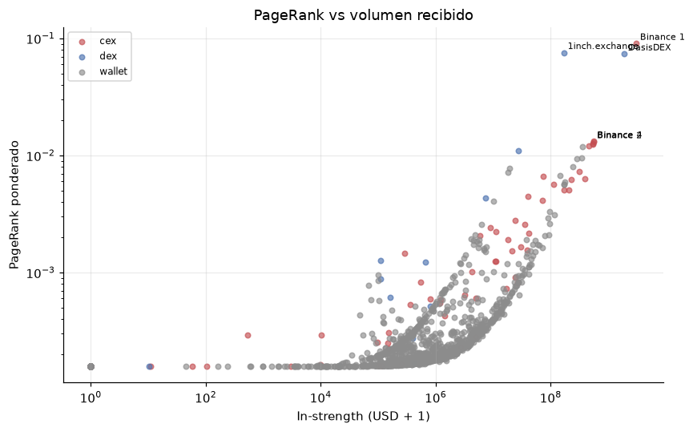

# 4. Tarea 2 — Importancia sistémica con PageRank ponderado

## 4.1 Problema real y modelo de grafos

No todos los exchanges son igualmente importantes. Algunos concentran volumen, otros conectan muchas contrapartes, otros actúan como intermediarios entre ecosistemas. Una medida útil debe capturar no solo **cuánto** volumen recibe un nodo, sino **desde dónde** y **cómo se propaga** ese volumen.

Sea `G = (V, E, w)` un grafo **dirigido y ponderado**:

- `V`: exchanges etiquetados + las 2.000 contrapartes principales.
- `(u, v) ∈ E`: existe al menos un flujo stablecoin de `u` a `v`.
- `w(u, v)`: volumen total en USD transferido de `u` a `v` durante el periodo.

La importancia se modela como la probabilidad estacionaria de un **paseo aleatorio con reinicio**: con probabilidad `d` se sigue una arista saliente elegida proporcionalmente a su peso; con probabilidad `1-d` se reinicia en un vértice uniforme. Eso es exactamente PageRank.

> **Idea clave.** PageRank no mide “cuánto dinero entra”. Mide “qué tan probable es que un paseo aleatorio esté en este nodo”. Un nodo puede recibir poco volumen y aun así ser importante si muchas fuentes lo alimentan y él redistribuye.

## 4.2 Celda 14 — Construcción del grafo dirigido

```python
t2 = flows[
    (flows["src"] != flows["dst"])
    & (flows["src"] != ZERO_ADDRESS)
    & (flows["dst"] != ZERO_ADDRESS)
].copy()

t2 = t2.groupby(["src", "dst"], as_index=False).agg(
    volume_usd=("volume_usd", "sum"),
    n_transfers=("n_transfers", "sum"),
)

name_map = dict(zip(flows["src"], flows["src_name"]))
name_map.update(dict(zip(flows["dst"], flows["dst_name"])))
type_map = dict(zip(flows["src"], flows["src_type"]))
type_map.update(dict(zip(flows["dst"], flows["dst_type"])))

nodes_t2 = sorted(set(t2["src"]) | set(t2["dst"]))
out_edges = defaultdict(list)
out_weight = defaultdict(float)
in_weight = defaultdict(float)
in_degree = Counter()

for s, d, vol in zip(t2["src"], t2["dst"], t2["volume_usd"]):
    out_edges[s].append((d, float(vol)))
    out_weight[s] += float(vol)
    in_weight[d] += float(vol)
    in_degree[d] += 1
```

Puntos finos:

- Se eliminan auto-lazos y la dirección cero. Un auto-lazo en PageRank se comportaría como una arista que devuelve masa al mismo nodo; no aporta y distorsiona.
- `groupby(["src","dst"]).sum()` garantiza una sola arista por par ordenado, aunque el archivo ya viene agregado. Es una salvaguarda.
- `name_map` y `type_map` se construyen con las columnas de origen y destino; así cualquier nodo tiene nombre y tipo, aunque aparezca solo como `src` o solo como `dst`.
- `out_edges[u]` guarda pares `(vecino, peso)`; `out_weight[u]` es la suma de pesos salientes; `in_weight[v]` la suma entrante.
- `in_degree[v]` cuenta **aristas entrantes distintas**, no transferencias. Se usa solo para la columna descriptiva `degree`.

Resultados:

```text
Vértices: 2,075 | Aristas: 6,727
Volumen total: USD 16.34 mil M
Nodos colgantes (sin salida): 716
```

> **Ojo.** Hay 716 nodos colgantes: nodos sin ninguna arista saliente (por ejemplo, billeteras que solo reciben). Si no se manejan, PageRank pierde masa en cada iteración y la suma deja de ser 1. El código los redistribuye uniformemente.

## 4.3 Celda 15 — PageRank por iteración de potencias

### La fórmula

Para un grafo dirigido con matriz de transición `M`, donde `M[u,v] = w(u,v)/W_out(u)`, PageRank satisface:

```text
PR(v) = (1-d)/N + d · Σ_u PR(u) · w(u,v)/W_out(u) + d · D/N
```

- `N = |V|`.
- `d = 0,85` es el factor de amortiguamiento.
- `D` es la masa total de los nodos colgantes (los que no tienen salida).
- El término `(1-d)/N` es el reinicio uniforme.
- El término `d·D/N` reparte la masa de los colgantes entre todos los nodos, para que no se pierda.

En forma matricial, PageRank es el vector propio principal de una matriz estocástica modificada. La iteración de potencias converge a ese vector propio porque el reinicio uniforme hace que la matriz sea primitiva y aperiódica.

### El código

```python
def pagerank(nodes, out_adj, out_w, damping=0.85, tol=1e-12, max_iter=500):
    n = len(nodes)
    pr = {u: 1.0 / n for u in nodes}
    dangling = [u for u in nodes if out_w[u] <= 0.0]
    history = []

    for it in range(max_iter):
        new = {u: (1.0 - damping) / n for u in nodes}
        dangling_mass = sum(pr[u] for u in dangling)

        for u in nodes:
            wu = out_w[u]
            if wu > 0.0:
                share = damping * pr[u] / wu
                for v, w in out_adj[u]:
                    new[v] += share * w

        if dangling_mass > 0.0:
            add = damping * dangling_mass / n
            for u in nodes:
                new[u] += add

        diff = sum(abs(new[u] - pr[u]) for u in nodes)
        pr = new
        history.append(diff)
        if diff < tol:
            break
    return pr, it + 1, history
```

### Explicación línea por línea

| Línea | Qué hace | Por qué |
|---|---|---|
| `pr = 1/n` | Inicialización uniforme | Es la distribución inicial más neutral; cualquier distribución con suma 1 converge al mismo punto fijo |
| `dangling = [...]` | Detecta nodos sin salida | Sin tratamiento, su masa desaparece |
| `new = (1-d)/n` | Teleportación | Asegura que todos los nodos reciban algo y que la matriz sea irreducible |
| `dangling_mass = sum(pr[u])` | Masa en colgantes | Se calcula con la iteración anterior |
| `share = d * pr[u] / wu` | Cuota de `u` | Reparte la masa de `u` proporcionalmente al peso de cada arista |
| `new[v] += share * w` | Propaga | Acumula la contribución de todas las entradas |
| `add = d * dangling_mass / n` | Reparte colgantes | Equivale a aristas virtuales de cada colgante a todos los nodos |
| `diff = Σ \|new-pr\|` | Error L1 | Criterio de convergencia simple y barato |
| `if diff < tol: break` | Para | `1e-12` es más que suficiente para que la suma sea 1 a 10 decimales |

### Por qué la suma se mantiene en 1

Cada iteración es una operación lineal sobre un vector de suma 1:

- La teleportación aporta `(1-d)` en total.
- La propagación aporta `d · (1 - masa_colgante)`.
- El reparto de colgantes aporta `d · masa_colgante`.

La suma es `(1-d) + d = 1`. La salida lo confirma:

```text
PageRank ponderado: 137 iteraciones en 0.187 s
PageRank no ponderado: 118 iteraciones
Suma PageRank ponderado: 1.0000000000
Suma PageRank no ponderado: 1.0000000000
```

### PageRank no ponderado

```python
unweighted_edges = {u: [(v, 1.0) for v, _ in out_edges[u]] for u in nodes_t2}
unweighted_out = {u: float(len(unweighted_edges[u])) for u in nodes_t2}
pr_unweighted, it_u, hist_u = pagerank(nodes_t2, unweighted_edges, unweighted_out)
```

Todas las aristas valen 1. Esto mide **conectividad**: quién recibe enlaces de muchos nodos, sin importar el volumen. Comparar ambos rankings separa el efecto “volumen” del efecto “topología”.

### Complejidad

- Una iteración recorre todos los nodos y todas las aristas: `O(V+E)`.
- Con `k` iteraciones: `O(k(V+E))`.
- En este grafo: 137 iteraciones, 0,187 s.
- No se usa álgebra lineal densa ni `scipy`; todo es diccionario y bucle.

> **Idea clave.** La iteración de potencias es solo “repetir la fórmula hasta que deje de cambiar”. No hay magia ni descomposición matricial.

## 4.4 Celda 16 — Ranking, correlaciones y figuras

```python
pr_df = pd.DataFrame({
    "address": nodes_t2,
    "name": [name_map.get(u, short_addr(u)) for u in nodes_t2],
    "type": [type_map.get(u, "wallet") for u in nodes_t2],
    "pr_weighted": [pr_weighted[u] for u in nodes_t2],
    "pr_unweighted": [pr_unweighted[u] for u in nodes_t2],
    "in_strength": [in_weight[u] for u in nodes_t2],
    "out_strength": [out_weight[u] for u in nodes_t2],
    "degree": [len(out_edges[u]) + in_degree[u] for u in nodes_t2],
})
pr_df["rank_weighted"] = pr_df["pr_weighted"].rank(ascending=False, method="min").astype(int)
...
exchanges_t2 = pr_df[pr_df["type"] != "wallet"].sort_values("pr_weighted", ascending=False)
```

- `in_strength` es la suma de USD que entra al nodo; `out_strength` la que sale.
- `degree` suma aristas salientes distintas y entrantes distintas; no es el grado ponderado.
- `rank(method="min")` da el mismo rango a los empates y salta números, como en una competencia.
- `exchanges_t2` filtra solo exchanges para el ranking principal; las billeteras se excluyen de la tabla, pero siguen en el grafo y en PageRank.

### Spearman sin scipy

```python
def spearman(a, b):
    return a.rank().corr(b.rank())
```

El coeficiente de Spearman es la correlación de Pearson entre los **rangos**. `Series.rank()` maneja empates con el rango promedio; `corr()` calcula Pearson. Así se evita depender de `scipy.stats.spearmanr`, que no está en los requisitos. Es una implementación correcta y suficiente.

Resultados:

```text
Spearman PageRank ponderado vs no ponderado: 0.6788
Spearman PageRank ponderado vs in-strength:   0.8389
Solapamiento top-20 PageRank vs in-strength: 17 / 20
```

Interpretación:

- `0,6788` no es perfecto: el peso por volumen cambia el orden. Si fuera 1, el volumen no aportaría nada; si fuera 0, el ranking sería completamente distinto.
- `0,8389` indica que el volumen recibido explica buena parte del ranking, pero no todo. Quedan 3 de 20 exchanges que entran al top-20 por topología y no por volumen.
- El solapamiento 17/20 es una forma intuitiva de decir “se parecen, pero no son lo mismo”.

### Tabla top-10

| Rank | Exchange | Tipo | PageRank | PageRank sin peso | In-strength (USD) | Rank in-strength |
|---:|---|---|---:|---:|---:|---:|
| 1 | Binance 1 | CEX | 0,090411 | 0,093409 | 3.116.539.000 | 1 |
| 2 | 1inch.exchange | DEX | 0,075536 | 0,079535 | 172.095.900 | 18 |
| 3 | OasisDEX | DEX | 0,073547 | 0,059077 | 1.931.111.000 | 2 |
| 4 | Binance 4 | CEX | 0,013197 | 0,000252 | 561.195.500 | 3 |
| 5 | Binance 2 | CEX | 0,013056 | 0,000252 | 555.163.400 | 4 |
| 6 | Binance 3 | CEX | 0,012679 | 0,000377 | 538.909.800 | 6 |
| 7 | Poloniex 4 | CEX | 0,012388 | 0,008811 | 552.006.100 | 5 |
| 8 | FTX Exchange | CEX | 0,012150 | 0,015170 | 469.295.800 | 7 |
| 10 | ParaSwap | DEX | 0,011068 | 0,014998 | 27.980.390 | 60 |
| 15 | Binance 7 | CEX | 0,007343 | 0,000354 | 320.174.100 | 11 |



### Los tres casos que debes saber explicar

**Binance 1 domina.** Tiene el mayor volumen y la mayor cantidad de conexiones; su PageRank es 0,090, casi 7 veces el cuarto. Es el hub del ecosistema.

**1inch es el caso interesante.** Su volumen recibido es USD 172 M, 18 veces menor que los USD 3.116 M de Binance 1, pero su PageRank es 0,0755, solo 17 % menor. ¿Por qué? Porque muchas contrapartes le envían flujos y él los redistribuye; su posición topológica es la de un agregador. PageRank premia esa intermediación.

**Binance 4/2/3 muestran el efecto del peso.** Sin pesos, su PageRank es ≈0,00025 (casi irrelevante); con pesos, ≈0,013 (top-6). Reciben pocas aristas, pero de enorme volumen. Eso es exactamente lo que el PageRank ponderado debe capturar y el no ponderado no.

**OasisDEX combina ambas cosas.** Tiene USD 1.931 M de entrada (rank 2) y una posición central (rank 3). Su PageRank alto es consistente con su rol de mercado descentralizado.

> **Ojo.** El texto del notebook dice que 1inch tiene “≈ USD 172 M vs ≈ USD 3.116 millones”. Es correcto: 172 M es el **in-strength** de 1inch; 3.116 M es el de Binance 1. No confundas con el volumen total de la red (16.340 M).

## 4.5 Resultados y defensa

### Lo que hay que decir

- 2.075 nodos, 6.727 aristas dirigidas, USD 16,34 mil M de volumen agregado.
- PageRank ponderado: Binance 1 (0,0904), 1inch (0,0755), OasisDEX (0,0735).
- 137 iteraciones, 0,187 s, suma exacta 1.
- Spearman ponderado vs no ponderado 0,6788; vs in-strength 0,8389; top-20 17/20.
- 716 nodos colgantes manejados con reparto uniforme.

### Preguntas finas

> **Si preguntan: “¿Por qué `d=0,85`?”** Es el valor estándar de PageRank. Con `d` alto, el paseo sigue más aristas y la medida es más local; con `d` bajo, pesa más el reinicio y el ranking se acerca a la uniformidad. `0,85` da una memoria efectiva de ~6-7 pasos y es robusto. No se hizo barrido de sensibilidad; se puede proponer como trabajo futuro.

> **Si preguntan: “¿Por qué no resolver el sistema lineal?”** Porque `N=2.075` es pequeño, pero la iteración de potencias es más simple, usa solo `O(E)` memoria y converge en 137 iteraciones. Resolver un sistema denso sería `O(N^3)` y no aportaría precisión útil.

> **Si preguntan: “¿PageRank converge siempre?”** Para esta matriz sí: el reinicio uniforme `(1-d)/N > 0` hace que la cadena sea irreducible y aperiódica, así que existe una única distribución estacionaria y la iteración converge a ella. El criterio L1 < `1e-12` es una condición de parada práctica.

> **Si preguntan: “¿Qué pasa con los nodos colgantes?”** Se reparte su masa uniformemente entre todos los nodos en cada iteración. Sin eso, la masa se perdería y la suma bajaría de 1. Es la convención estándar.

> **Si preguntan: “¿No es trampa usar el volumen como peso y luego comparar con in-strength?”** No: in-strength es una línea base sin propagación. La comparación muestra que el volumen solo explica parte del ranking; la topología aporta el resto. Es exactamente el contraste que se busca.

<!-- pagebreak -->
