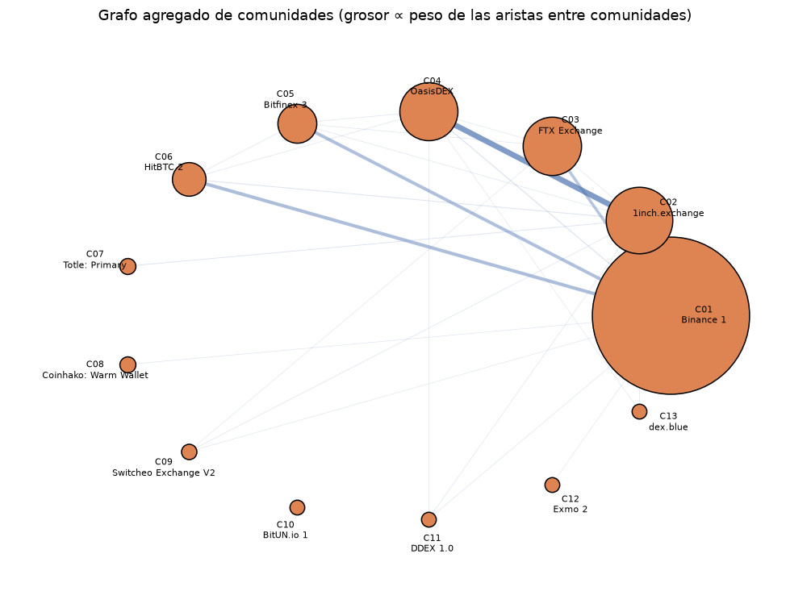

# 5. Tarea 3 — Comunidades de liquidez con Louvain

## 5.1 Problema real y modelo de grafos

Los exchanges y sus contrapartes no forman un mercado homogéneo. Hay ecosistemas conectados más intensamente entre sí: un exchange con sus market makers habituales, un agregador DEX con sus billeteras, un grupo de exchanges que comparten liquidez. Detectar esas comunidades permite segmentar el mercado, identificar rutas de arbitraje y entender qué actores comparten liquidez.

Sea `G = (V, E, w)` un grafo **no dirigido y ponderado**:

- `V`: exchanges + contrapartes principales (los mismos nodos de T2).
- `{u, v} ∈ E`: existe flujo stablecoin en al menos una dirección entre `u` y `v`; se suman ambas direcciones.
- `w(u, v)`: **número total de transferencias** entre `u` y `v` (frecuencia).

Una comunidad es un conjunto de nodos con más aristas internas que las esperadas por azar. La calidad se mide con la **modularidad**:

```text
Q = (1/2m) · Σ_ij [ A_ij - γ · k_i·k_j/(2m) ] · δ(c_i, c_j)
     = Σ_c [ in_c/m - γ · (tot_c/(2m))^2 ]
```

- `A`: matriz de adyacencia ponderada.
- `k_i`: fuerza (suma de pesos) del nodo `i`.
- `m`: suma de pesos de todas las aristas.
- `c_i`: comunidad del nodo `i`.
- `in_c`: peso interno de la comunidad `c`.
- `tot_c`: suma de fuerzas de los nodos de `c`.
- `γ`: resolución; `1,0` es el valor estándar.

`Q` compara la fracción de aristas internas con la que se esperaría si las aristas se colocaran al azar conservando los grados. `Q=0` es una partición aleatoria; `Q` cercano a 1 es una estructura muy fuerte. En redes reales, `Q` entre 0,3 y 0,7 suele considerarse una estructura significativa, aunque no hay un umbral universal.

> **Idea clave.** Louvain no “descubre la verdadera” partición: optimiza una función heurística. `Q=0,614` significa que la partición explica bien la estructura, no que sea la única posible.

## 5.2 Celda 19 — Grafo no dirigido ponderado por frecuencia

```python
g_t3 = defaultdict(dict)
for s, d, n in zip(t2["src"], t2["dst"], t2["n_transfers"]):
    if s == d:
        continue
    w = float(n)
    g_t3[s][d] = g_t3[s].get(d, 0.0) + w
    g_t3[d][s] = g_t3[d].get(s, 0.0) + w
g_t3 = {u: dict(neighbors) for u, neighbors in g_t3.items()}
nodes_t3 = sorted(g_t3)
n_edges_t3 = sum(len(v) for v in g_t3.values()) // 2
```

- Se toma `n_transfers`, no `volume_usd`. La razón: unas pocas transferencias gigantes pueden dominar la partición si se usa volumen; la frecuencia mide **intensidad de relación** y es más robusta.
- La arista se inserta en ambas direcciones. Si existen flujos `A→B` y `B→A`, los conteos se suman. El grafo resultante es no dirigido y simétrico.
- `n_edges_t3 = Σ len(vecinos)/2` porque cada arista aparece dos veces.
- Los auto-lazos ya se filtraron en T2 (`src != dst`), así que no hay `s == d`.

Resultados:

```text
Vértices: 2,075 | Aristas no dirigidas: 6,134
Peso total (transferencias): 493,645
```

> **Ojo.** El peso total 493.645 es la suma de `n_transfers` de las aristas dirigidas. Como cada arista no dirigida se cuenta dos veces, la suma de pesos del grafo no dirigido es 493.645; el código divide por 2 solo para contar aristas, no para el peso. Es consistente con la definición de `m` en modularidad.

## 5.3 Celda 20 — Modularidad, Louvain y Label Propagation

### 5.3.1 La función de modularidad

```python
def modularity(adj, loops, comm, resolution=1.0):
    m = sum(sum(adj[u].values()) for u in adj) / 2 + sum(loops.values())
    if m == 0:
        return 0.0
    in_c = defaultdict(float)
    tot_c = defaultdict(float)
    for u in adj:
        cu = comm[u]
        tot_c[cu] += sum(adj[u].values()) + 2 * loops.get(u, 0.0)
        in_c[cu] += loops.get(u, 0.0)
        for v, w in adj[u].items():
            if v > u and comm[v] == cu:
                in_c[cu] += w
    return sum(in_c[c] / m - resolution * (tot_c[c] / (2 * m)) ** 2
               for c in set(comm.values()))
```

- `m` es la suma de pesos: cada arista no dirigida se cuenta dos veces en `sum(adj)`, por eso `/2`; los auto-lazos se suman una vez.
- `tot_c` es la suma de fuerzas de los nodos de la comunidad. Un auto-lazo contribuye `2·loops` al grado, por eso `+ 2*loops[u]`.
- `in_c` es el peso interno. Se recorre cada arista una sola vez con `v > u`; los auto-lazos se suman aparte.
- La fórmula implementada es exactamente `Σ_c [in_c/m - γ(tot_c/(2m))²]`.
- `set(comm.values())` evita sumar comunidades vacías.

### 5.3.2 Louvain, fase por fase

```python
def louvain_once(orig_nodes, adj0, resolution=1.0, seed=0, max_levels=20):
    rng = random.Random(seed)
    adj = {u: dict(adj0[u]) for u in orig_nodes}
    loops = {u: 0.0 for u in orig_nodes}
    membership = {u: u for u in orig_nodes}
    levels = []

    for level in range(max_levels):
        m = sum(sum(adj[u].values()) for u in adj) / 2 + sum(loops.values())
        if m == 0:
            break
        k = {u: sum(adj[u].values()) + 2 * loops[u] for u in adj}
        tot = dict(k)
        comm = {u: u for u in adj}
        order = sorted(adj)
        moves_total = 0

        for _ in range(200):
            rng.shuffle(order)
            moved = 0
            for u in order:
                ci = comm[u]
                nc = defaultdict(float)
                for v, w in adj[u].items():
                    if v != u:
                        nc[comm[v]] += w
                tot[ci] -= k[u]
                best_c, best_gain = ci, 0.0
                for c, w in nc.items():
                    gain = w / m - resolution * tot.get(c, 0.0) * k[u] / (2 * m * m)
                    if gain > best_gain + 1e-12:
                        best_gain, best_c = gain, c
                if best_c != ci:
                    comm[u] = best_c
                    tot[best_c] += k[u]
                    moved += 1
                else:
                    tot[ci] += k[u]
            moves_total += moved
            if moved == 0:
                break

        membership = {o: comm[v] for o, v in membership.items()}
        levels.append({"level": level, "n_comms": len(set(comm.values())),
                       "modularity": modularity(adj, loops, comm, resolution),
                       "moves": moves_total})
        if moves_total == 0:
            break

        new_adj = defaultdict(dict)
        new_loops = defaultdict(float)
        for u in adj:
            cu = comm[u]
            new_adj.setdefault(cu, {})
            new_loops[cu] += loops[u]
            for v, w in adj[u].items():
                if v < u:
                    continue
                cv = comm[v]
                if cu == cv:
                    new_loops[cu] += w
                else:
                    new_adj[cu][cv] = new_adj[cu].get(cv, 0.0) + w
                    new_adj[cv][cu] = new_adj[cv].get(cu, 0.0) + w
        adj = {u: dict(new_adj[u]) for u in new_adj}
        loops = {u: new_loops.get(u, 0.0) for u in adj}
        if len(adj) >= len(orig_nodes):
            break

    adj_orig = {u: dict(adj0[u]) for u in orig_nodes}
    loops0 = {u: 0.0 for u in orig_nodes}
    return membership, modularity(adj_orig, loops0, membership, resolution), levels
```

La estructura es la clásica de Louvain:

**Fase 1 — movimiento local.** Cada nodo empieza en su propia comunidad. Se recorre el grafo en orden aleatorio; para cada nodo `u` se calcula cuánto peso tiene hacia cada comunidad vecina (`nc`). Se saca temporalmente a `u` de su comunidad (`tot[ci] -= k[u]`), se evalúa la ganancia de moverlo a cada comunidad candidata y se queda con la mejor si supera `1e-12`. Si no se mueve, se restaura su contribución. Se repite hasta que ninguna asignación cambie o hasta 200 pasadas.

La ganancia que usa el código es:

```text
ΔQ(u → c) = w(u,c)/m - γ · tot_c · k_u / (2m²)
```

donde `tot_c` es la fuerza de la comunidad `c` **sin** `u` (por eso se resta antes). Es la diferencia entre el peso que `u` aportaría a `c` y el peso esperado por azar. Si es positiva, mover a `u` mejora la modularidad.

**Fase 2 — agregación.** Se construye un nuevo grafo cuyos nodos son las comunidades. Las aristas internas se convierten en **auto-lazos** (`new_loops`); las aristas entre comunidades se convierten en aristas del nuevo grafo, con peso acumulado. Se conserva `membership` para poder mapear cada nodo original a su comunidad final.

**Repetición.** Se repite el ciclo hasta que no haya movimientos o el grafo no se reduzca. `max_levels=20` es una cota de seguridad.

### 5.3.3 Los reinicios

```python
def louvain(nodes, adj, resolution=1.0, n_restarts=10, base_seed=0):
    best = None
    for r in range(n_restarts):
        mem, q, levels = louvain_once(nodes, adj, resolution, base_seed + r)
        if best is None or q > best[1] + 1e-12:
            best = (mem, q, levels, r)
    return best
```

Louvain es heurístico y depende del orden de recorrido. Con 10 reinicios (semillas 0 a 9) se reduce la probabilidad de quedarse en un mínimo local. Se conserva la partición con mayor `Q`. El mejor reinicio fue el 7.

### 5.3.4 Label Propagation

```python
def label_propagation(nodes, adj, max_iter=100, seed=42):
    rng = random.Random(seed)
    labels = {u: u for u in nodes}
    order = sorted(nodes)
    for _ in range(max_iter):
        rng.shuffle(order)
        changed = 0
        for u in order:
            counts = defaultdict(float)
            for v, w in adj[u].items():
                counts[labels[v]] += w
            if not counts:
                continue
            best = max(counts.values())
            candidates = [c for c, w in counts.items() if abs(w - best) < 1e-12]
            new = labels[u] if labels[u] in candidates else min(candidates)
            if new != labels[u]:
                labels[u] = new
                changed += 1
        if changed == 0:
            break
    return labels
```

Cada nodo adopta la etiqueta más frecuente entre sus vecinos, ponderada por el peso de la arista. Si hay empate, conserva su etiqueta si está entre las candidatas; si no, elige la menor. Esa regla de desempate evita oscilaciones. Es mucho más barato que Louvain, pero no optimiza modularidad explícitamente.

### 5.3.5 Resultados

```text
Louvain: 13 comunidades, Q = 0.6143, 0.291 s (mejor reinicio 7)
Label Propagation: 24 comunidades, Q = 0.6050
Q todos juntos = 0.0000 | Q cada nodo solo = -0.0799
```

| Nivel | Comunidades | Modularidad | Movimientos |
|---:|---:|---:|---:|
| 0 | 36 | 0,602073 | 2.276 |
| 1 | 13 | 0,614310 | 29 |
| 2 | 13 | 0,614310 | 0 |

La tabla de niveles es muy didáctica: en el primer nivel, el movimiento local produce 36 comunidades; la agregación las fusiona en 13; el tercer nivel ya no mueve nada. La modularidad sube de 0,602 a 0,614.

Las particiones triviales sirven de control:

- **Todos juntos:** `Q=0`. Es la línea base: no hay estructura.
- **Cada nodo solo:** `Q=-0,0799`. Peor que el azar; confirma que `Q` penaliza la fragmentación excesiva.

> **Idea clave.** Louvain mejora a Label Propagation en `Q` (0,614 vs 0,605) y produce menos comunidades (13 vs 24). LP es más barato, pero fragmenta más. No hay un ganador absoluto: depende de si se prioriza calidad o costo.

## 5.4 Celda 21 — Interpretación de comunidades

```python
node_strength = {u: sum(g_t3[u].values()) for u in g_t3}
raw_comms = sorted(set(best_mem.values()),
                   key=lambda c: -sum(1 for u in nodes_t3 if best_mem[u] == c))
comm_label = {c: f"C{i+1:02d}" for i, c in enumerate(raw_comms)}
best_mem_label = {u: comm_label[best_mem[u]] for u in nodes_t3}
```

- `node_strength` es la suma de pesos incidentes; se usa para ordenar los exchanges dentro de cada comunidad.
- `raw_comms` ordena las comunidades por tamaño y les asigna nombres legibles `C01`, `C02`, etc.
- `best_mem_label` traduce las etiquetas internas (números) a nombres.

Para cada comunidad se calcula:

- `size`: número de nodos.
- `n_cex`, `n_dex`, `n_wallet`: composición.
- `internal_weight_share`: peso interno / (fuerza total / 2). Es una medida descriptiva de cohesión; no es lo mismo que la contribución a `Q`.
- `top_exchanges`: los 5 exchanges con mayor fuerza dentro de la comunidad.

Resultados principales:

| Comunidad | Tamaño | CEX | DEX | Billeteras | Peso interno | Exchanges principales |
|---|---:|---:|---:|---:|---:|---|
| C01 | 1.346 | 44 | 0 | 1.302 | 95,96 % | Binance 1, Poloniex 4, Binance 2, Binance 4, … |
| C02 | 233 | 0 | 7 | 226 | 95,86 % | 1inch, ParaSwap, DEX.AG |
| C03 | 177 | 3 | 0 | 174 | 75,64 % | FTX, Bitmax 3, Huobi 12 |
| C04 | 175 | 1 | 2 | 172 | 98,64 % | OasisDEX, CREX24, EtherDelta 2 |
| C05 | 73 | 7 | 1 | 65 | 72,60 % | Bitfinex 3, KuCoin 1/2, Bittrex 1 |
| C06 | 52 | 2 | 0 | 50 | 80,49 % | HitBTC 2, HitBTC 3 |
| C07–C13 | 2–4 | — | — | — | 80–100 % | Comunidades pequeñas |



Lectura:

- **C01 es el ecosistema Binance.** 44 CEX, ninguna DEX, 1.302 billeteras; el 96 % de su peso es interno. Es un bloque denso y separado.
- **C02 es el ecosistema de agregadores DEX.** 1inch, ParaSwap y DEX.AG comparten billeteras y flujos; no hay CEX.
- **C03 y C04 son ecosistemas de exchanges concretos.** FTX/Bitmax/Huobi y OasisDEX/CREX24/EtherDelta.
- Las comunidades pequeñas (C07–C13) son exchanges o pools con pocas contrapartes; no son ruido, pero tampoco sostienen la estructura global.

> **Ojo.** La comunidad más grande no es “todos los exchanges grandes”: es el ecosistema Binance. Poloniex 4 aparece dentro de C01 porque comparte muchas contrapartes con Binance. Eso no significa que sean la misma empresa; significa que sus flujos y billeteras se solapan.

## 5.5 Celda 22 — Validación con la proyección exchange–exchange

```python
g_shared = defaultdict(dict)
for a, b, w in zip(shared["a"], shared["b"], shared["shared_wallets"]):
    if a == b or w <= 0:
        continue
    g_shared[a][b] = g_shared[a].get(b, 0.0) + float(w)
    g_shared[b][a] = g_shared[b].get(a, 0.0) + float(w)
g_shared = {u: dict(v) for u, v in g_shared.items()}

mem_shared, q_shared, levels_shared, restart_shared = louvain(
    shared_nodes, g_shared, n_restarts=10
)
```

Esta proyección responde otra pregunta: si se conectan los exchanges que comparten billeteras, ¿aparecen las mismas comunidades? El peso es el número de billeteras compartidas. Resultado:

```text
Proyección exchange-exchange: 88 nodos, 1213 aristas
Louvain: 6 comunidades, Q = 0.1491
Exchanges etiquetados que no comparten contrapartes principales: 208
```

- 88 exchanges conectados, 1.213 aristas: el grafo es **denso** (densidad ≈ 0,317). Casi todos comparten alguna billetera del top-2000.
- `Q=0,1491` es bajo. No significa que Louvain falle: significa que la proyección exchange–exchange **no tiene** una estructura comunitaria fuerte. Al agregar todas las billeteras en una sola arista, se pierde la información de a qué ecosistema pertenece cada billetera.
- 208 exchanges no comparten ninguna contraparte del top-2000; quedan fuera de la proyección. Es otra señal de fragmentación.

> **Idea clave.** La comparación es valiosa precisamente porque el resultado es distinto: las comunidades fuertes existen a nivel de **billetera–exchange**, no a nivel de **exchange–exchange**. Agregar de más destruye la señal.

## 5.6 Resultados y defensa

### Lo que hay que decir

- Grafo no dirigido de 2.075 nodos, 6.134 aristas y 493.645 transferencias de peso.
- Louvain: 13 comunidades, Q=0,6143, 0,291 s, mejor reinicio 7.
- Label Propagation: 24 comunidades, Q=0,6050.
- Comunidad mayor: ecosistema Binance, 1.346 nodos, 96 % de peso interno.
- Proyección exchange–exchange: 88 nodos, 6 comunidades, Q=0,1491.

### Preguntas finas

> **Si preguntan: “¿Por qué usar frecuencia y no volumen?”** Porque el volumen está muy concentrado: unas pocas transferencias de millones pueden dominar la partición. La frecuencia mide recurrencia de relación, que es más estable. El notebook menciona una sensibilidad por volumen, pero no se ejecutó; si preguntan, reconócelo y propónlo como trabajo futuro.

> **Si preguntan: “¿Por qué no Girvan–Newman?”** Porque su costo es `O(E²V)` y el grafo tiene más de 2.000 nodos y 6.000 aristas. Louvain es casi lineal por nivel y escala mejor. Girvan–Newman es más interpretable, pero inviable aquí.

> **Si preguntan: “¿Louvain garantiza el óptimo global?”** No. Es una heurística greedy. Los 10 reinicios y la comparación con LP y las particiones triviales dan confianza, pero no una garantía. El óptimo de modularidad es NP-difícil.

> **Si preguntan: “¿Q=0,614 es bueno?”** Es una estructura fuerte para una red real. No hay un umbral universal, pero 0,3 se considera señal y 0,6 es alto. Además, la partición trivial da 0 y la de nodos aislados da -0,08, así que el valor es informativo.

> **Si preguntan: “¿Por qué 13 comunidades y no 5 o 50?”** Porque es lo que emerge al optimizar `Q` con resolución 1,0 y 10 reinicios. No es un número “verdadero”. Se podría variar `γ` para explorar jerarquías; no se hizo.

> **Si preguntan: “¿Por qué la proyección tiene Q bajo?”** Porque es un grafo denso de 88 nodos donde casi todos comparten alguna billetera; la señal comunitaria se diluye. Las comunidades fuertes están en la red billetera–exchange, no en la proyección agregada.

> **Si preguntan: “¿Las billeteras no etiquetadas forman comunidades propias?”** Se adhieren a la comunidad del exchange con el que más interactúan. C01 tiene 1.302 billeteras y 44 CEX; C02 tiene 226 billeteras y 7 DEX. Eso es consistente con el modelo.

<!-- pagebreak -->
