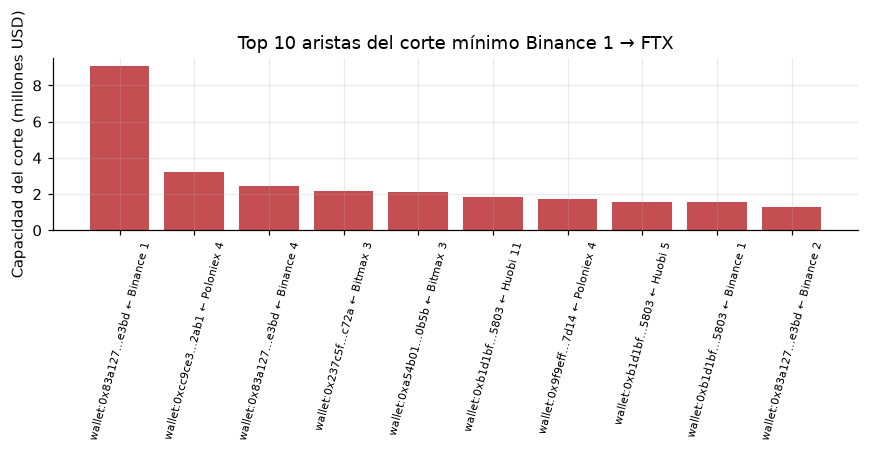
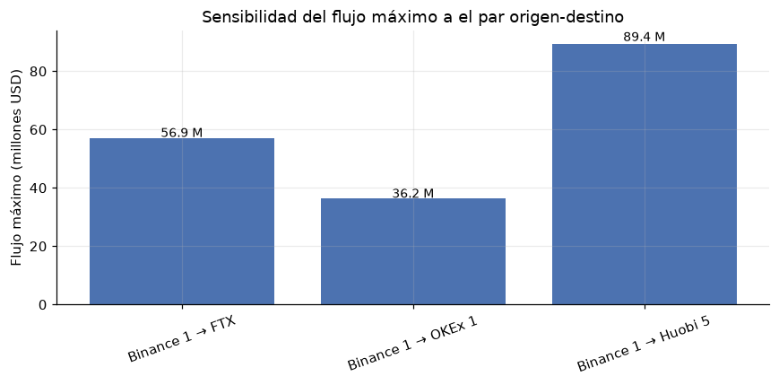

# 6. Tarea 4 — Capacidad máxima y cuellos de botella

## 6.1 Problema real y modelo de grafos

En una red de pagos no basta con saber quién está conectado: interesa **cuánta liquidez puede rutearse** entre dos exchanges y **dónde se corta** esa capacidad. Si se modelan los flujos observados como capacidades, el flujo máximo entre un origen y un destino indica la capacidad estructural de la red; el corte mínimo identifica las aristas que la limitan.

Sea `G = (V, E, c)` una **red de flujo dirigida**:

- `V`: exchanges + contrapartes principales.
- `(u, v) ∈ E`: existe flujo stablecoin de `u` a `v`.
- `c(u,v)`: volumen total en USD transferido de `u` a `v` (capacidad).
- `s`: Binance 1 (origen); `t`: FTX Exchange (destino).

Un flujo factible `f` cumple:

```text
0 ≤ f(u,v) ≤ c(u,v)                    para toda arista
Σ_u f(u,v) = Σ_w f(v,w)                para todo v ≠ s,t (conservación)
```

El **flujo máximo** `f*` es la máxima cantidad de USD que puede enviarse de `s` a `t`. Por el **teorema max-flow/min-cut**, `f*` es igual a la capacidad del corte mínimo que separa `s` de `t`. Las aristas de ese corte son los cuellos de botella.

> **Idea clave.** El flujo máximo no dice “cuánto se transfirió realmente”; dice “cuánto podría rutearse como máximo si se usaran todas las rutas disponibles con las capacidades observadas”. Es una cota estructural.

### La advertencia que debes hacer en voz alta

Las capacidades son **volúmenes agregados de 19 meses**, no capacidades instantáneas. El resultado `USD 56,85 M` es una cota acumulada, no un límite diario ni una predicción. Tampoco se modela el orden temporal: una ruta que usa transferencias de fechas distintas puede no ser factible en la realidad. Decir esto antes de que lo pregunte el profesor demuestra criterio.

## 6.2 Celda 25 — Dinic y Edmonds–Karp

### 6.2.1 Dinic

```python
class Dinic:
    def __init__(self, n):
        self.n = n
        self.g = [[] for _ in range(n)]

    def add_edge(self, u, v, cap):
        self.g[u].append([v, cap, len(self.g[v])])
        self.g[v].append([u, 0.0, len(self.g[u]) - 1])

    def max_flow(self, s, t, eps=1e-9):
        flow = 0.0
        augmentations = 0
        last_level = []
        while True:
            level = [-1] * self.n
            level[s] = 0
            q = deque([s])
            while q:
                u = q.popleft()
                for v, cap, _ in self.g[u]:
                    if cap > eps and level[v] < 0:
                        level[v] = level[u] + 1
                        q.append(v)
            last_level = level
            if level[t] < 0:
                break
            it = [0] * self.n

            def dfs(u, pushed):
                if u == t:
                    return pushed
                while it[u] < len(self.g[u]):
                    e = self.g[u][it[u]]
                    v, cap, rev = e
                    if cap > eps and level[v] == level[u] + 1:
                        tr = dfs(v, min(pushed, cap))
                        if tr > eps:
                            e[1] -= tr
                            self.g[v][rev][1] += tr
                            return tr
                    it[u] += 1
                return 0.0

            while True:
                pushed = dfs(s, float("inf"))
                if pushed <= eps:
                    break
                flow += pushed
                augmentations += 1
        return flow, augmentations, last_level
```

### La representación del grafo residual

Cada arista se guarda como una lista mutable `[vecino, capacidad_residual, índice_reverso]`. Al agregar `u → v` con capacidad `c`:

1. Se agrega la arista directa en `g[u]` con capacidad `c`.
2. Se agrega la arista reversa en `g[v]` con capacidad `0`.
3. El campo `rev` de la directa apunta al índice de la reversa en `g[v]`; el de la reversa apunta al índice de la directa en `g[u]`.

Cuando se empuja `tr` por la directa:

```python
e[1] -= tr                    # baja la capacidad residual directa
self.g[v][rev][1] += tr       # sube la capacidad residual reversa
```

La arista reversa es lo que permite **deshacer** un envío anterior. Sin ella, el algoritmo sería greedy y se quedaría atascado en un flujo subóptimo. Esa es la diferencia entre un camino aumentante y un simple camino.

### Fase BFS: grafo de niveles

```python
level = [-1] * self.n
level[s] = 0
q = deque([s])
while q:
    u = q.popleft()
    for v, cap, _ in self.g[u]:
        if cap > eps and level[v] < 0:
            level[v] = level[u] + 1
            q.append(v)
```

El BFS recorre solo aristas con capacidad residual positiva y asigna a cada nodo su **nivel** = número de aristas desde `s`. Esto no es Dijkstra: no usa pesos ni distancias en USD; usa número de saltos. Si `t` no es alcanzable, no hay camino aumentante y el flujo es máximo.

### Fase DFS: flujo bloqueante

El DFS solo avanza por aristas que suben exactamente un nivel (`level[v] == level[u] + 1`). Así se construye un **flujo bloqueante**: un conjunto de caminos que satura el grafo de niveles. `it[u]` es el **puntero de avance** (*current arc*): recuerda por qué arista va `u` para no volver a explorar las que ya fallaron.

Detalle fino:

- Si el DFS empuja flujo por una arista, **no** incrementa `it[u]`; la arista puede seguir teniendo capacidad y se reutiliza.
- Si la arista no puede empujar nada, incrementa `it[u]` y pasa a la siguiente.
- Cuando `it[u]` llega al final, `u` queda muerto en este nivel y el DFS devuelve 0.

El bucle exterior repite BFS + DFS hasta que no haya camino. `last_level` se guarda por completitud, pero el corte se calcula después con otra BFS sobre el residual.

### Complejidad

- Dinic general: `O(V²E)`.
- En redes unitarias o bipartitas: `O(E√V)`.
- En la práctica, mucho mejor que la cota. Aquí: 2.075 nodos, 6.727 aristas, 0,019 s.

### 6.2.2 Edmonds–Karp

```python
def edmonds_karp(n, edges, s, t, eps=1e-9):
    cap = [defaultdict(float) for _ in range(n)]
    adj = [set() for _ in range(n)]
    for u, v, c in edges:
        cap[u][v] += c
        adj[u].add(v)
        adj[v].add(u)

    flow = 0.0
    augmentations = 0
    while True:
        parent = [-1] * n
        parent[s] = s
        q = deque([s])
        while q and parent[t] == -1:
            u = q.popleft()
            for v in adj[u]:
                if parent[v] == -1 and cap[u][v] > eps:
                    parent[v] = u
                    q.append(v)
        if parent[t] == -1:
            break

        bottleneck = float("inf")
        v = t
        while v != s:
            u = parent[v]
            bottleneck = min(bottleneck, cap[u][v])
            v = u

        v = t
        while v != s:
            u = parent[v]
            cap[u][v] -= bottleneck
            cap[v][u] += bottleneck
            v = u
        flow += bottleneck
        augmentations += 1
    return flow, augmentations
```

- `cap` es una matriz dispersa de capacidades residuales; `adj` incluye las direcciones reversas para que el BFS pueda deshacer.
- El BFS encuentra **cualquier** camino `s→t` en el residual, no necesariamente el más corto en peso; sí es el de menor número de aristas.
- Se calcula el cuello de botella del camino y se actualizan las capacidades directas y reversas.
- Complejidad: `O(VE²)`. Es correcto y simple, pero más lento que Dinic en grafos grandes.

### 6.2.3 Construcción de la red de capacidades

```python
cap_edges = defaultdict(float)
for s, d, vol in zip(t2["src"], t2["dst"], t2["volume_usd"]):
    cap_edges[(s, d)] += float(vol)
cap_nodes = sorted(set(s for s, _ in cap_edges) | set(d for _, d in cap_edges))
node_idx = {u: i for i, u in enumerate(cap_nodes)}
edge_list = [(node_idx[s], node_idx[d], c) for (s, d), c in cap_edges.items()]
```

- Se agregan volúmenes por par ordenado; si hubiera duplicados, se suman.
- Se indexan los nodos con enteros porque Dinic y EK usan listas, no diccionarios.
- Resultado: 2.075 nodos, 6.727 aristas, capacidad total instalada USD 16,34 mil M.

## 6.3 Celda 26 — Ejecución, corte mínimo y sensibilidad

```python
SRC = "0x3f5ce5fbfe3e9af3971dd833d26ba9b5c936f0be"  # Binance 1
DST = "0x2faf487a4414fe77e2327f0bf4ae2a264a776ad2"  # FTX Exchange
assert SRC in node_idx and DST in node_idx

def run_dinic(src, dst):
    t0 = time.perf_counter()
    din = Dinic(len(cap_nodes))
    for u, v, c in edge_list:
        din.add_edge(u, v, c)
    flow, aug, level = din.max_flow(node_idx[src], node_idx[dst])
    elapsed = time.perf_counter() - t0
    return din, flow, aug, elapsed, level
```

- `SRC` y `DST` son direcciones exactas, no nombres. Los nombres pueden repetirse o cambiar; la dirección es la clave.
- `assert` falla si alguno no está en la red, lo que evita un `KeyError` confuso.
- `run_dinic` reconstruye el grafo en cada llamada para que las pruebas de sensibilidad sean independientes.

### Corte mínimo

```python
reachable = [False] * len(cap_nodes)
reachable[node_idx[SRC]] = True
q = deque([node_idx[SRC]])
while q:
    u = q.popleft()
    for v, cap, _ in din.g[u]:
        if cap > eps and not reachable[v]:
            reachable[v] = True
            q.append(v)

cut_edges = []
for (s, d), c in cap_edges.items():
    if reachable[node_idx[s]] and not reachable[node_idx[d]]:
        cut_edges.append((c, s, d))
cut_edges.sort(reverse=True)
cut_total = sum(c for c, _, _ in cut_edges)
assert abs(cut_total - flow_dinic) < 1e-2
```

Después del flujo máximo, en el grafo residual no existe camino `s→t`. Se marca el conjunto `S` de nodos alcanzables desde `s` usando solo aristas con capacidad residual positiva. El corte mínimo son las aristas originales que van de `S` a `V\S`. Por el teorema max-flow/min-cut, su capacidad total es exactamente el flujo máximo; el `assert` lo verifica con tolerancia de un centavo.

> **Ojo.** El corte se calcula sobre las aristas **originales** (`cap_edges`), no sobre las residuales. Es correcto: el corte es una partición de vértices; las aristas que lo cruzan son las originales. La BFS sobre el residual solo sirve para encontrar `S`.

### Resultados

```text
Dinic:        flujo = USD 56.85 M | aumentos = 216 | tiempo = 0.0191 s
Edmonds-Karp: flujo = USD 56.85 M | aumentos = 216 | tiempo = 0.1130 s
Razón de tiempo EK/Dinic: 5.9×
¿Mismo valor? True
Corte mínimo: 168 aristas, capacidad = USD 56.85 M
```

| Métrica | Valor |
|---|---:|
| Flujo máximo Binance 1 → FTX | USD 56.850.000 aprox. |
| Aumentos (Dinic) | 216 |
| Aumentos (Edmonds–Karp) | 216 |
| Aristas del corte mínimo | 168 |
| Capacidad del corte | USD 56,85 M |
| Tiempo Dinic | 0,0191 s |
| Tiempo Edmonds–Karp | 0,1130 s |
| Razón EK/Dinic | 5,9× |

> **Ojo.** El texto del notebook dice “≈ 7,6 veces más rápido” y cita 0,015 s vs 0,114 s. Esos valores vienen de una corrida anterior. En la ejecución guardada, la razón es **5,9×**. Al presentar, di “aproximadamente 6 veces” y aclara que el tiempo absoluto depende del entorno. Si puedes, corrige la línea del notebook antes de entregar.

### Top del corte

| Capacidad (USD) | Origen | Destino |
|---:|---|---|
| 9.053.219 | Binance 1 | wallet `0x83a1…e3bd` |
| 3.208.362 | Poloniex 4 | wallet `0xcc9c…2ab1` |
| 2.435.271 | Binance 4 | wallet `0x83a1…e3bd` |
| 2.149.987 | Bitmax 3 | wallet `0x237c…c72a` |
| 2.124.983 | Bitmax 3 | wallet `0xa54b…0b5b` |
| 1.846.402 | Huobi 11 | wallet `0xb1d1…5803` |
| 1.710.000 | Poloniex 4 | wallet `0x9f9e…7d14` |
| 1.556.896 | Huobi 5 | wallet `0xb1d1…5803` |
| 1.546.130 | Binance 1 | wallet `0xb1d1…5803` |
| 1.267.976 | Binance 2 | wallet `0x83a1…e3bd` |



La interpretación es importante: el cuello de botella **no es una sola tubería**. Es un conjunto de 168 aristas que cruzan la frontera del conjunto alcanzable. Las mayores son salidas de Binance 1, Poloniex 4, Binance 4, Bitmax 3 y Huobi hacia billeteras que no tienen ruta de vuelta hacia FTX. Esas billeteras absorben liquidez y no la devuelven al circuito.

### Sensibilidad

```python
pairs = [
    ("Binance 1 → FTX", SRC, DST),
    ("Binance 1 → OKEx 1", SRC, "0x6cc5f688a315f3dc28a7781717a9a798a59fda7b"),
    ("Binance 1 → Huobi 5", SRC, "0x5c985e89dde482efe97ea9f1950ad149eb73829b"),
]
```

| Par | Flujo máximo | Aumentos | Tiempo |
|---|---:|---:|---:|
| Binance 1 → FTX | USD 56,85 M | 216 | 0,0142 s |
| Binance 1 → OKEx 1 | USD 36,24 M | 167 | 0,0630 s |
| Binance 1 → Huobi 5 | USD 89,41 M | 150 | 0,0174 s |



- **FTX:** 56,85 M.
- **OKEx 1:** 36,24 M, más restrictivo.
- **Huobi 5:** 89,41 M, más holgado.

La capacidad depende fuertemente del destino. Eso es esperable: la red no es simétrica y cada exchange tiene un conjunto distinto de rutas y contrapartes.

## 6.4 Resultados y defensa

### Lo que hay que decir

- Red de 2.075 nodos y 6.727 aristas con capacidades en USD.
- Flujo máximo Binance 1 → FTX: USD 56,85 M.
- Dinic y Edmonds–Karp coinciden exactamente en el valor; validación cruzada.
- 216 aumentos; 168 aristas de corte; corte = flujo (teorema verificado con `assert`).
- Sensibilidad: OKEx 36,24 M; Huobi 89,41 M.
- En la ejecución guardada, Dinic es ~5,9× más rápido; el texto del notebook cita 7,6× de una corrida previa.

### Preguntas finas

> **Si preguntan: “¿Por qué el flujo es solo 56,85 M si Binance 1 mueve 3.116 M?”** Porque el flujo máximo no es el volumen total: es lo máximo que puede llegar a FTX por rutas que respeten capacidades. La mayor parte del volumen de Binance sale hacia billeteras que son sumideros y no tienen camino hacia FTX. El corte de 168 aristas cuantifica esa frontera.

> **Si preguntan: “¿Por qué 168 aristas y no una?”** Porque el corte es la frontera completa entre el conjunto alcanzable desde Binance y el resto. Muchas billeteras absorben flujo sin devolverlo; cada una aporta su arista. Las 10 mayores concentran la mayor parte de la capacidad, pero el corte incluye todas.

> **Si preguntan: “¿Dinic y EK dan el mismo número de aumentos; entonces son iguales?”** No. Los 216 de Dinic son **empujes exitosos del DFS** dentro de flujos bloqueantes; los 216 de EK son **augmentaciones BFS**. La coincidencia es circunstancial. La diferencia real está en el tiempo y en cómo se organiza el trabajo: Dinic reutiliza el grafo de niveles y evita un BFS por cada camino.

> **Si preguntan: “¿El flujo es entero?”** No necesariamente. Las capacidades son USD con decimales, así que el flujo es real. El teorema max-flow/min-cut vale para capacidades reales; la integralidad solo se garantiza con capacidades enteras.

> **Si preguntan: “¿Por qué `eps=1e-9`?”** Porque se comparan flotantes. Sin una tolerancia, una capacidad residual de `1e-16` podría considerarse positiva y generar bucles. `1e-9` es mucho menor que un centavo y mucho mayor que el error de redondeo típico.

> **Si preguntan: “¿Por qué no Push–Relabel?”** Dinic es más simple de implementar y explicar, y en esta red es muy rápido. Push–Relabel podría ser más rápido en grafos densos, pero no era necesario. Es una alternativa válida para trabajo futuro.

> **Si preguntan: “¿El corte mínimo es único?”** No. Puede haber varios cortes con la misma capacidad. El que se reporta es el que induce la BFS sobre el residual después de este flujo máximo; otro flujo máximo podría dar otro corte del mismo valor.

> **Si preguntan: “¿Por qué no usar Dijkstra para el camino aumentante?”** Porque el camino aumentante no necesita ser el de menor peso; cualquier camino en el residual sirve. Edmonds–Karp usa BFS por número de aristas para garantizar la cota `O(VE²)`. Dinic usa niveles por saltos. Dijkstra sería innecesario y más costoso.

<!-- pagebreak -->
